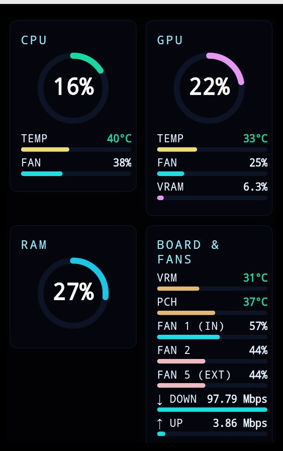
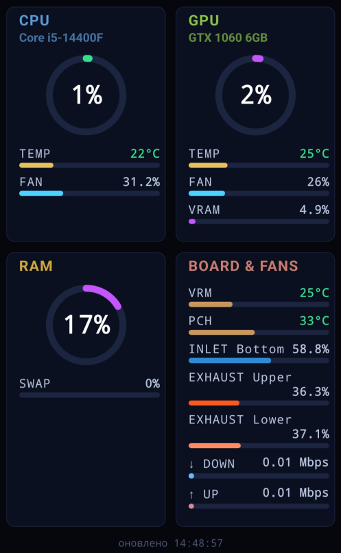

# ExtDash — другий екран для моніторингу ПК зі старого телефону

[English](README.md) | **Українська**

Перетворює будь-який телефон із браузером на живий дашборд для Linux-ПК:
CPU, GPU, RAM, SWAP, температури материнської плати, корпусні вентилятори, мережа.
Дані оновлюються в реальному часі, окремий застосунок на телефон не потрібен.

Ця версія — **Linux**. Версія для Windows розробляється окремо.

**Не впевнені в кроках встановлення?** Унизу є промт для ШІ-асистента: вставте його в діалог, і асистент проведе вас покроково й безпечно (див. розділ «Встановлення з допомогою ШІ-асистента»).

## Скріншоти

| HTC One S (Android 4.1.1, 2012) | OnePlus 9 (LineageOS) |
|---|---|
|  |  |

Той самий `index.html` відкривається і на телефоні 2012 року, і на сучасному.

## Як це працює

```
Телефон (браузер) ──HTTP──► Flask-сервер (порт 8080)
                              ├── Glances API (127.0.0.1:61208): CPU, GPU, RAM, SWAP, мережа
                              └── lm-sensors (sensors -j): вентилятори, VRM, PCH
```

Сервер `pc_dashboard_server.py` об'єднує дані Glances і `sensors -j` в один
JSON (`/data`) і віддає сторінку `index.html`. Які саме сенсори показувати,
визначає `sensor_config.json`, який створює `setup_wizard.py`.

## Що показує дашборд

| Блок | Дані |
|---|---|
| CPU | Навантаження %, температура, вентилятор % |
| GPU | Навантаження %, температура, вентилятор %, VRAM % (показується лише за наявності GPU) |
| RAM | Використання %, під ним SWAP |
| Board & Fans | VRM і PCH температури, довільна кількість корпусних вентиляторів, швидкість мережі (↓/↑) |
| System | Load average (1/5/15 хв), uptime, використання диска `/` (показується лише без GPU, див. `system_block`) |

Якщо GPU немає, блок GPU не показується: CPU і RAM стоять у ряд, а нижній
блок займає всю ширину.

Якщо VRM, PCH і вентилятори не налаштовано (наприклад, на ноутбуці), нижній
блок називається **Network** і показує лише швидкість мережі.

Назви блоків CPU і GPU можна задати власні (див. «Встановлення», крок 3).

Відсоток вентилятора рахується з реальних обертів:
`(RPM − мін) / (макс − мін)`. Тому мінімум і максимум для кожного
вентилятора потрібно задати вручну (див. нижче).

## Вимоги

- Linux, Python 3.10+ (перевірено на Python 3.12, Linux Mint, і на Python 3.11.2, MX Linux 23.4)
- `lm-sensors` з налаштованими датчиками
- Glances 4.x з веб-режимом, Flask
- `nvidia-ml-py` — лише для відеокарт NVIDIA (GPU-дані Glances бере через нього)
- ПК і телефон в одній локальній мережі

Перевірені версії: Glances 4.5.6–4.5.7, Flask 3.1.3, nvidia-ml-py 13.610–13.615.

## Встановлення

1. Системні пакети і датчики:

   ```bash
   sudo apt install lm-sensors python3-venv curl
   sudo sensors-detect      # відповідайте "yes" на типові питання
   ```

2. Python-залежності у віртуальному середовищі (працює і на дистрибутивах
   із PEP 668, де `pip` не ставить пакети в систему):

   ```bash
   python3 -m venv ~/extdash-venv
   ~/extdash-venv/bin/pip install "glances[web]" flask
   ~/extdash-venv/bin/pip install nvidia-ml-py    # лише для відеокарт NVIDIA
   ```

   Далі в усіх командах використовуйте `~/extdash-venv/bin/python` і
   `~/extdash-venv/bin/glances`.

3. Завантажте проєкт у `~/ExtDash` і запустіть майстер налаштування:

   ```bash
   git clone https://github.com/Norman-byte/ExtDash-linux.git ~/ExtDash
   cd ~/ExtDash
   ~/extdash-venv/bin/python setup_wizard.py
   ```

   Майстер показує всі знайдені вентилятори й температури; ви вибираєте
   CPU-кулер, корпусні вентилятори, датчики CPU/VRM/PCH і мережевий
   інтерфейс. Результат записується в `sensor_config.json` поруч зі скриптом.

   - Вентилятори обирайте за назвою секції (`System Fan #N`), а не за
     порядковим номером у списку: після кожного вибору список перенумеровується.
   - Назви CPU/GPU: Enter — назва визначається автоматично (ключ у файл не
     пишеться), власна назва — вводите текст, `-` — блок без назви.
  - Блок System: Enter — автоматично (показується лише без GPU, ключ не
    пишеться), `y` — завжди показувати, `n` — ніколи не показувати (майстер
    пише `"system_block": true` або `false`).
   - **Кирилицю в майстрі не вводьте:** редагування рядка в терміналі з нею
     працює некоректно. Українську назву впишіть вручну в `sensor_config.json`
     (UTF-8), наприклад `"cpu_name": "Ноут ASUS"`.
   - Якщо у вас немає якогось датчика (наприклад, VRM чи PCH на ноутбуці),
     обирайте 0. Датчик `acpitz` не є VRM чи PCH.
   - **Майстер перезаписує `sensor_config.json`.** Якщо працююча конфігурація
     вже є, спершу зробіть її копію.

4. Запуск вручну (для перевірки):

   ```bash
   cd ~/ExtDash
   ~/extdash-venv/bin/glances -w -B 127.0.0.1 &
   ~/extdash-venv/bin/python pc_dashboard_server.py
   ```

   `-B 127.0.0.1` робить так, що Glances слухає лише локально (порт 61208);
   телефон підключається тільки до сервера на порту 8080.

   Відкрийте на телефоні `http://<IP-вашого-ПК>:8080`.
   Дані у форматі JSON: `http://<IP-вашого-ПК>:8080/data`.

   Сервер читає `sensor_config.json` лише під час старту: після будь-якої
   зміни конфігурації перезапустіть сервер.

## Вимірювання RPM для вентиляторів

Майстер запитує мінімальні та максимальні оберти кожного вентилятора.
Значень за замовчуванням немає: діапазон залежить від моделі й розміру,
а хибний діапазон дає хибні відсотки.

- **Максимум** — оберти на повній швидкості. Для корпусних вентиляторів
  майстер може виміряти його сам: за вашою згодою (потрібен `sudo`)
  вентилятор на кілька секунд переводиться на 100%, після чого попередній
  режим керування повертається. Це працює, якщо драйвер надає керування
  `pwmN` для цього вентилятора (перевірено на nct6687). Для CPU-вентилятора
  і помпи автовимір не виконується: введіть максимум вручну (специфікація,
  BIOS/UEFI або інша програма моніторингу). Якщо автовимір не вдався,
  майстер теж попросить ввести значення вручну.
- **Мінімум** — завжди вводиться вручну: найнижчі оберти, на яких
  вентилятор стабільно крутиться. Оберти на холостому ході можуть бути
  вищими за реальний мінімум, тому брати їх не варто. Джерела:
  специфікація, BIOS/UEFI або інша програма моніторингу. Якщо мінімум
  невідомий, введіть 0, тоді відсоток рахується від максимуму. Для
  вентиляторів, що зупиняються, мінімум теж 0.
- Поточні оберти видно у списку майстра та у виводі `sensors`.

Не визначайте мінімум самостійним зниженням PWM: деякі вентилятори
зупиняються і самі не запускаються.

Максимум має бути більшим за мінімум.

## Автозапуск

Оберіть варіант за вашою системою ініціалізації (`ps -p 1 -o comm=`).

### A) systemd (режим користувача)

У теці `systemd/` лежать шаблони сервісів. Вони припускають, що проєкт
знаходиться в `~/ExtDash`, а Glances і Python — у venv `~/extdash-venv`.
Якщо це не так, виправте шляхи в `ExecStart`.

```bash
mkdir -p ~/.config/systemd/user
cp systemd/*.service ~/.config/systemd/user/
systemctl --user daemon-reload
systemctl --user enable --now glances-extdash.service pc-dashboard-extdash.service
loginctl enable-linger "$USER"     # щоб сервіси стартували без входу в систему
```

Перевірка: `systemctl --user status pc-dashboard-extdash.service`.

### B) без systemd (sysvinit та інші)

Скрипт `start_extdash.sh` запускає Glances (з `-B 127.0.0.1`) і сервер, а
файл `autostart/extdash.desktop` викликає його при вході в графічну сесію
(з паузою 10 секунд). Проєкт має лежати в `~/ExtDash`.

```bash
mkdir -p ~/.config/autostart
cp ~/ExtDash/autostart/extdash.desktop ~/.config/autostart/
```

Логи пишуться в `~/.cache/extdash/`.

**Увага:** `start_extdash.sh` зупиняє всі запущені процеси `glances -w` і
`pc_dashboard_server.py`, а потім стартує їх заново. Не запускайте його на
машині, де працює сервіс systemd або інший робочий екземпляр.

## Безпека

Сервер слухає на `0.0.0.0:8080` **без автентифікації** і віддає дані про
апаратну частину ПК. Використовуйте лише в довіреній локальній мережі й не
відкривайте порт назовні.

Glances слухає лише `127.0.0.1:61208` і назовні не доступний.

Якщо на ПК увімкнено `ufw`, дозвольте порт 8080 тільки зі своєї підмережі
(підставте свою):

```bash
sudo ufw allow from 192.168.1.0/24 to any port 8080 proto tcp
```

## Обмеження

- Набір датчиків залежить від обладнання. Наприклад, на ноутбуках зазвичай
  немає `cpu_fan`, GPU, VRM і PCH. Датчик `acpitz` не є VRM чи PCH.
- Якщо GPU немає, блок GPU не показується.
- Блок System (load average, uptime, диск `/`) показується лише без GPU.
  Щоб змінити це, вкажіть `"system_block": true` або `false` у
  `sensor_config.json`; без ключа або `"auto"` режим автоматичний.
- Сервер читає `sensor_config.json` лише на старті.

## Температура GPU на Linux

Linux-версія показує температуру **ядра (Core)**. NVIDIA не надає
hotspot/junction-температуру через Linux-драйвери ні в `nvidia-smi`, ні в
NVML. Реальна температура кристала в найгарячішій точці зазвичай на
10–20 °C вища, тому залишайте запас до теплового ліміту виробника.

## Встановлення з допомогою ШІ-асистента

Якщо ви не впевнені в якомусь кроці, скористайтеся готовим промтом:
[docs/INSTALL_PROMPT.md](docs/INSTALL_PROMPT.md). Скопіюйте його вміст і
вставте в діалог із ШІ-асистентом (Claude чи іншим). Асистент розпізнає
ваше обладнання, запитає, що саме ви хочете бачити на дашборді, і проведе
вас покроково: по одній команді, з відкатом і бекапом перед правками.

## Ліцензія

MIT — використовуйте, змінюйте, поширюйте вільно.

## Про розробку

Проєкт створено в парі з Claude (Anthropic): від реанімації старого
HTC One S до Linux-бекенду. Усе розбиралося й тестувалося крок за кроком,
включно з реальними глухими кутами (обмеження NVIDIA-драйверів на Linux,
розбіжності між PWM і реальними обертами) та їхніми практичними рішеннями.
